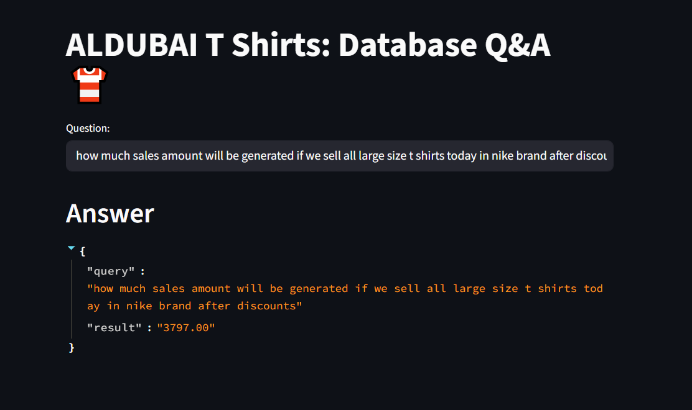

# ALDUBAI Tees: Talk to a Database

An end-to-end LLM project built with Google Gemini and LangChain. The system lets you talk to a MySQL database in plain English — you ask a question, it converts it to SQL, runs it, and returns the answer.

ALDUBAI Tees is a T-shirt store that manages inventory, sales, and discount data in a MySQL database. A store manager can ask questions like:
- How many white color Nike t-shirts do we have left in stock?
- How much revenue will we generate if we sell all extra-small t-shirts after applying discounts?



## Project Highlights

- ALDUBAI Tees sells Adidas, Nike, Van Heusen and Levi's t-shirts
- Inventory, sales and discount data is stored in a MySQL database
- Built an LLM-based question and answer system using:
  - Google Gemini 2.5 Flash LLM
  - Hugging Face embeddings
  - Streamlit for UI
  - LangChain framework
  - ChromaDB as a vector store
  - Few-shot learning for better SQL accuracy

## Installation

1. Clone this repository:

```bash
git clone https://github.com/Ebrahim667/aldubai-tshirts-db-qa.git
```

2. Navigate to the project directory:

```bash
cd aldubai-tshirts-db-qa
```

3. Install the required dependencies:

```bash
pip install -r requirements.txt
```

4. Get a Google API key from [Google AI Studio](https://aistudio.google.com) and create a `.env` file using `.env.example` as a template:

```bash
GOOGLE_API_KEY="your_api_key_here"
DB_PASSWORD="your_mysql_password_here"
```

5. For database setup, run `database/db_creation_aldubai_tshirts.sql` in your MySQL Workbench

## Usage

1. Run the Streamlit app:

```bash
streamlit run main.py
```

2. The web app will open in your browser where you can ask questions in natural language

## Sample Questions
- How many total t-shirts are left in stock?
- How many t-shirts do we have left for Nike in XS size and white color?
- How much is the total price of the inventory for all S-size t-shirts?
- How much sales will be generated if we sell all Levi's t-shirts today after discounts?
- How many white color Levi's shirts do we have?

## Project Structure

- `main.py` — Streamlit application
- `langchain_helper.py` — All LangChain logic (LLM, DB chain, few-shot prompt)
- `few_shots.py` — Few-shot examples for better SQL generation
- `requirements.txt` — Required Python packages
- `database/db_creation_aldubai_tshirts.sql` — MySQL database setup script
- `.env.example` — Template showing which environment variables are needed
